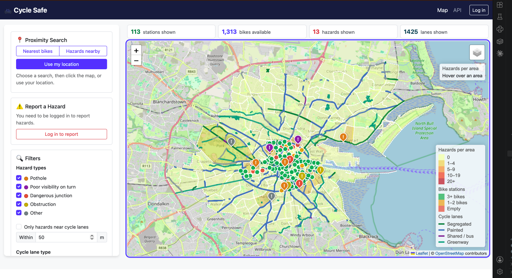
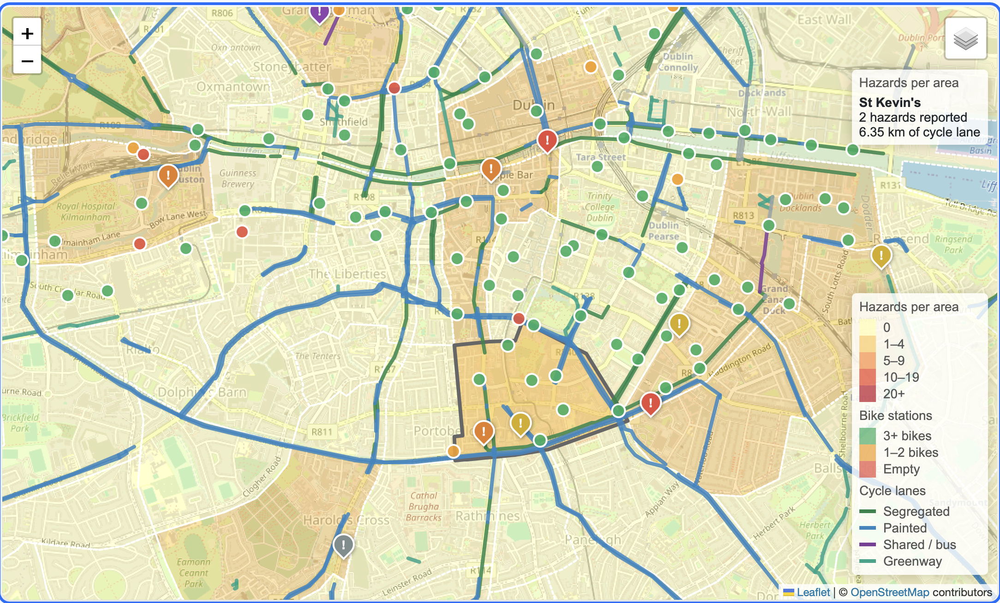
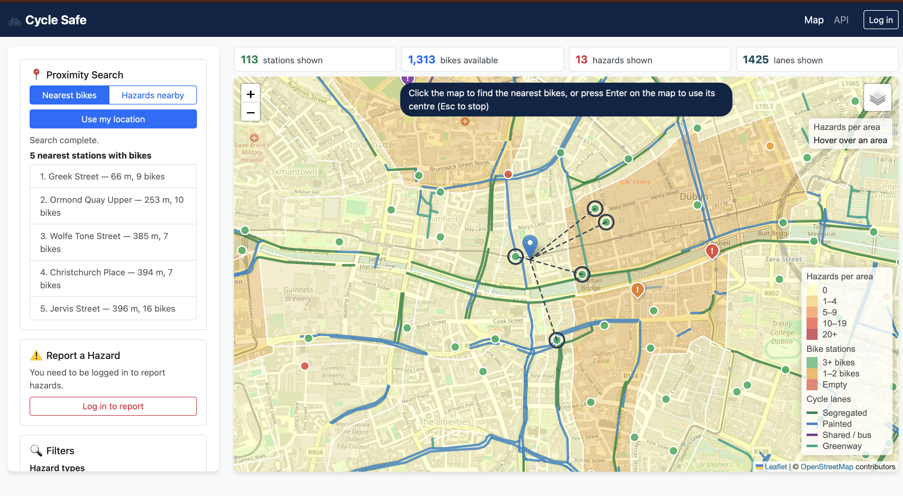
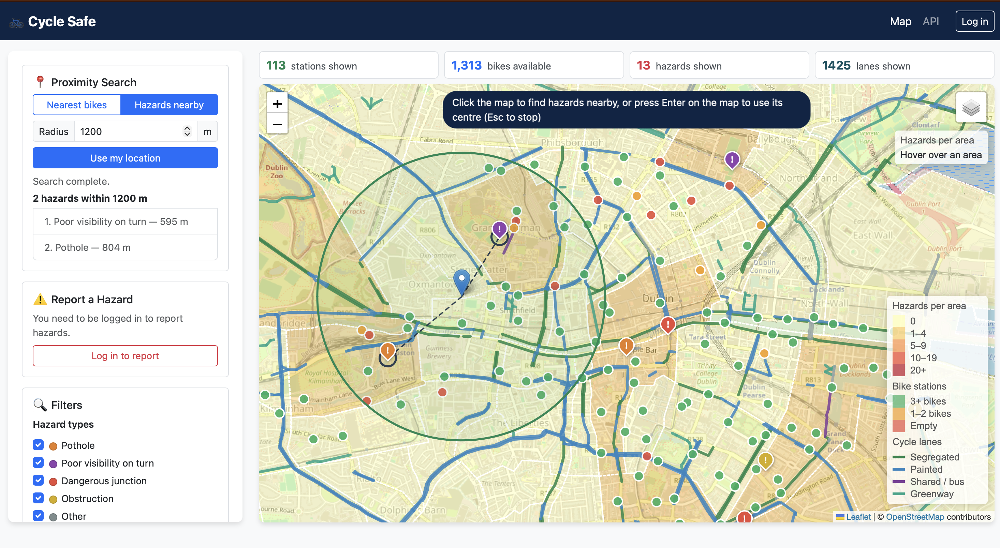
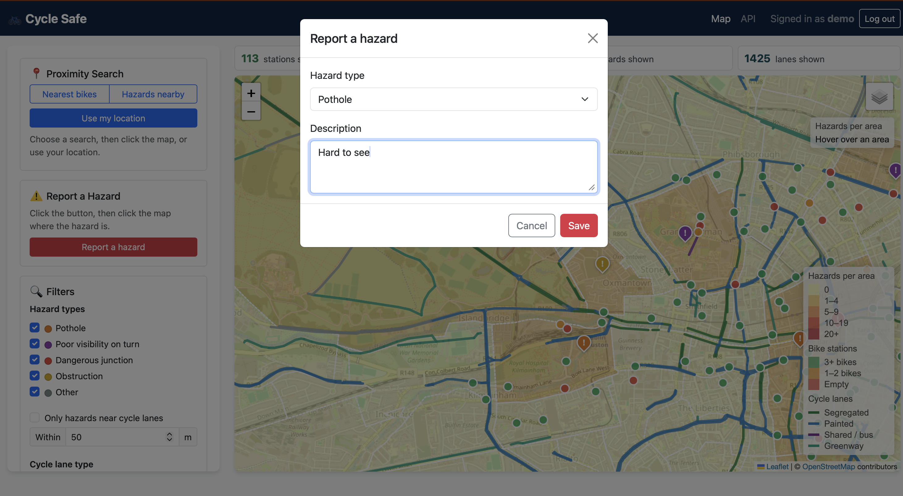
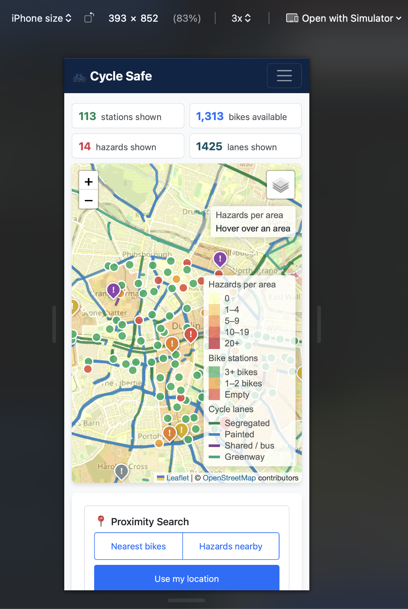
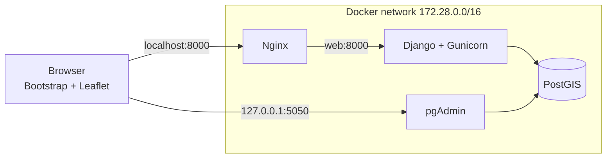

# Cycle Safe - Dublin Cycle Safety Planner

A location-based web app for cycling in Dublin. It maps bike-share stations, cycle lanes and road
hazards. Logged-in users can report hazards (potholes, poor visibility, dangerous junctions), and
everyone can find the nearest bikes, search for hazards around a point and see which areas have the
most hazards.

Built with Django (GeoDjango), PostgreSQL/PostGIS and Leaflet, running in Docker behind Nginx.

**Test login:** `demo` / `cyclesafe-demo`

## Screenshots

| Map overview | Hazards per area |
|---|---|
|  |  |
| **Nearest bikes** | **Hazards nearby** |
|  |  |
| **Report a hazard** | **Phone view** |
|  |  |

## Features

- Map layers for bike stations, hazards, cycle lanes and areas, with OpenStreetMap or CyclOSM backgrounds
- Areas coloured by hazard count; hovering shows hazards and km of cycle lane
- **Nearest bikes** and **Hazards nearby** searches from a map click or your location
- Filters: hazard type, hazards near cycle lanes, lane type, stations with bikes
- Report, edit and delete hazards (only the reporter can edit their own)
- GeoJSON export, login with a demo account, keyboard and screen-reader support, phone layout

## Technology stack

| Layer | Technology |
|-------|------------|
| Database | PostgreSQL 16 + PostGIS 3.4, pgAdmin 4 |
| Backend | Django 5.1 (GeoDjango), Django REST Framework, djangorestframework-gis, django-filter, Gunicorn |
| Front end | Bootstrap 5.3, Leaflet 1.9.4, OpenStreetMap |
| Deployment | Docker Compose, Nginx reverse proxy, custom subnet `172.28.0.0/16` |

## Architecture



Nginx is the only way into the site and serves the static files. Django and the database are only
reachable inside the Docker network. Data is kept in Docker volumes across restarts.

Django's MVC pattern: models and spatial queries in `cycles/models.py`, logic in `cycles/views.py`
(API and map page), and templates in `templates/` with `static/js/map.js` loading data from the API.

## Setup

Requires Docker Desktop and Git.

1. Clone the repository and create the environment file:
   ```bash
   git clone https://github.com/Harry-Delaney/Dublin-Cycle-safety-planner.git
   cd Dublin-Cycle-safety-planner
   cp .env.example .env
   ```
2. Edit `.env`:
   - `DJANGO_SECRET_KEY`: generate one with `python3 -c "import secrets; print(secrets.token_urlsafe(50))"`
   - `POSTGRES_PASSWORD`, `PGADMIN_DEFAULT_EMAIL` and `PGADMIN_DEFAULT_PASSWORD`: your own values
   - `DEMO_USER_PASSWORD`: leave as `cyclesafe-demo` to create the demo account
3. Build and start the containers, then load the data (areas, lanes, stations, demo user and
   12 sample hazards):
   ```bash
   docker compose up -d --build
   docker compose exec web python manage.py load_all_data
   ```
4. Optionally create an admin account for `/admin/`:
   ```bash
   docker compose exec web python manage.py createsuperuser
   ```

Migrations and static files run automatically when the web container starts. Open:
- Map: http://localhost:8000
- API: http://localhost:8000/api/
- Admin: http://localhost:8000/admin/
- pgAdmin: http://127.0.0.1:5050 (register a server with host `db`, port `5432` and the
  `POSTGRES_*` values from `.env`)

**Useful commands**
```bash
docker compose ps                                      # container status
docker compose logs web --tail 30                      # Django / Gunicorn logs
docker compose exec web python manage.py test cycles   # run the 26 tests
docker compose down                                    # stop (data is kept in volumes)
```
After changing code, run `docker compose up -d --build` again, as the production setup doesn't
reload code automatically.

## Test credentials

| Account | Username | Password | Can do |
|---------|----------|----------|--------|
| Demo user | `demo` | `cyclesafe-demo` | Report hazards, and edit or delete their own (owns the 12 sample hazards) |
| Admin | made with `createsuperuser` | your choice | Django admin, and edit any hazard |

## Cloud deployment

Not done, as the brief says local deployment is sufficient. On a cloud server
the same setup would need the domain in `DJANGO_ALLOWED_HOSTS`, an HTTPS certificate in Nginx and
`DJANGO_HTTPS=True`.

## User guide

- **Nearest bikes:** click **Nearest bikes**, then click the map. The 5 closest stations are listed with distances.
- **Hazards nearby:** click **Hazards nearby**, set the radius, then click the map.
- **Report a hazard:** log in, click **Report a hazard**, click the map and fill in the form. Click
  your hazard's pin to **Edit** or **Delete** it.
- **Filters:** choose options, then click **Apply Filters**. The **Within** distance only applies
  when **Only hazards near cycle lanes** is ticked.
- **Map:** drag to pan, scroll or use **+ / −** to zoom, and use the layers button (top right) to
  change the background or hide layers. Click any station, hazard or lane for its details.
- **Hazards per area:** hover over an area to see its hazards and km of cycle lane; click to zoom in.
- **Export:** the **Export Data** buttons download the hazards or stations shown as GeoJSON.
- **Keyboard:** Tab through the controls (the first Tab shows a "Skip to main content" link). To
  search without a mouse, choose the search, Tab to the map, move it with the arrow keys and press
  **Enter** to use the map centre. **Esc** cancels a search.

## Spatial queries

| Query | Used for | PostGIS | Endpoint |
|-------|----------|---------|----------|
| Nearest neighbour | Nearest bikes | KNN `<->`, re-sorted by `ST_DistanceSphere` | `/api/stations/nearest/` |
| Within radius | Hazards nearby | `ST_DistanceSphere` | `/api/hazards/nearby/` |
| Distance to lines | Hazards near lanes | `ST_DistanceSphere` in a subquery | `/api/hazards/near_lanes/` |
| Containment | Hazards per area | `ST_Within` | `/api/areas/hazard_counts/` |
| Intersection + length | Km of lane per area | `ST_Intersection`, `ST_Length` | `/api/areas/lane_lengths/` |
| Bounding box | Loading data in an area | `&&` | `?in_bbox=` |

The KNN operator measures in degrees, which put stations in the wrong order in Dublin, so the
closest candidates are re-sorted by real distance in metres. The same queries as SQL are in
[`docs/demo_queries.sql`](docs/demo_queries.sql).

## API

Base URL `/api/`. Responses are GeoJSON. Anyone can read; creating hazards needs login, and only the
reporter can edit or delete.

| Method | Endpoint | Notes |
|--------|----------|-------|
| GET | `/stations/`, `/lanes/`, `/areas/`, `/hazards/` | Lists (filters below) |
| GET | `/stations/nearest/?lat=&lng=&limit=` | `limit` default 5, max 50 |
| GET | `/hazards/nearby/?lat=&lng=&distance=` | metres, default 500, max 5000 |
| GET | `/hazards/near_lanes/?distance=` | metres, default 50, max 1000 |
| GET | `/areas/hazard_counts/`, `/areas/lane_lengths/` | adds `hazard_count`, `lane_length_km` |
| POST | `/hazards/` | login required |
| PATCH / DELETE | `/hazards/{id}/` | reporter only |

Example: report a hazard with `POST /api/hazards/` (logged in):
```json
{
  "type": "Feature",
  "geometry": { "type": "Point", "coordinates": [-6.2652, 53.3306] },
  "properties": { "hazard_type": "pothole", "description": "Deep pothole in the cycle lane" }
}
```
`hazard_type` is one of `pothole`, `poor_visibility`, `dangerous_junction`, `obstruction`, `other`.
The reporter and dates are set by the server. Search results include a `distance_m` field, e.g.
`/api/hazards/nearby/?lat=53.3306&lng=-6.2652&distance=500` returns the Portobello pothole at
`0.0` m and the wheelie bins at `232.5` m.

Filters: `has_bikes`, `min_bikes` (stations); `hazard_type`, `mine`, `reported_after` (hazards);
`lane_type` (lanes); `in_bbox` (all). Invalid input returns HTTP 400, e.g.
`{"error": "distance must be greater than 0 and no more than 5000."}`.

## Database schema

All geometries use SRID 4326 with GiST spatial indexes (`cycles/migrations/0001_initial.py`).

| Table | Geometry | Main fields |
|-------|----------|-------------|
| `BikeStation` | Point | station_id, name, capacity, available_bikes, available_stands |
| `HazardReport` | Point | hazard_type, description, reported_by (→ User), created_at, updated_at |
| `CycleLane` | LineString | name, lane_type, source |
| `Area` | MultiPolygon | name, code |

## Data sources

Open data, CC BY 4.0, loaded from `data/` by `load_all_data`:
- **Bike stations:** [Dublinbikes API DCC](https://data.gov.ie/en_GB/dataset/dublinbikes-api), Dublin City Council (113 stations, downloaded 30 Oct 2026)
- **Cycle lanes:** [Dublin Cycle Infrastructure 2025](https://data.gov.ie/dataset/nta-active-travel-cycle-network-dublin), National Transport Authority (1,425 lanes, clipped to Dublin City)
- **Areas:** [Electoral Divisions DCC](https://data.smartdublin.ie/dataset/electoral-divisions-dcc), Smart Dublin (162 areas)
- **Hazards:** 12 sample hazards written for the demo, plus user reports
- Map tiles © OpenStreetMap contributors and CyclOSM

## Security and accessibility


**Security**
- `DEBUG=False`, and the secret key and passwords come from `.env`, which is not committed or copied
  into the Docker image
- Gunicorn runs behind Nginx; the database has no port open to the host and pgAdmin only listens on `127.0.0.1`
- The web container runs as a non-root user on a custom Docker subnet
- Nginx hides its version and adds security headers; Django adds clickjacking protection, and
  secure cookies and HSTS when `DJANGO_HTTPS=True`
- CSRF protection on every change, login needed to report, and only the reporter can edit or delete

**Accessibility** (designed towards WCAG 2.1 AA)
- Everything works with a keyboard, with a skip link and visible focus outlines
- Labels on all form controls, and search results and errors are read out by screen readers
- AA colour contrast, and a responsive layout with larger buttons on phones

## Known issues

- Bike availability is a snapshot from 30 Oct 2026, not live
- Dublinbikes only covers the city centre, so suburbs like Ballymun and Finglas have no stations
- Runs locally over HTTP only (no cloud deployment)
- On phones the map legend covers part of the map
- Hazards can't be moved, only deleted and re-reported
- The "Within" distance in the filters only applies when "Only hazards near cycle lanes" is ticked
- pgAdmin keeps the login it was first started with; changing it in `.env` needs the `pgadmin_data` volume removed

## References

- Django: https://docs.djangoproject.com/ (GeoDjango, QuerySets, authentication, CSRF, static files)
- PostGIS: https://postgis.net/documentation/ (KNN, distance, containment and intersection functions)
- Leaflet: https://leafletjs.com/ (GeoJSON, layers control, choropleth and mobile tutorials)
- Django REST Framework, djangorestframework-gis and Bootstrap 5 documentation
- Week 5 lab (proximity search) and Week 6 lab (GeoJSON REST API and map dashboard)
